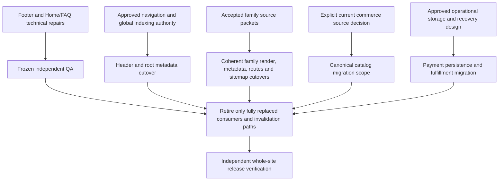

# Remaining Sanity cutovers implementation plan

> **For AI:** Execute each scoped cutover only after its source and authority gates are recorded; this plan is not approval of those gates.

**Goal:** Retire remaining Sanity dependencies without losing approved bilingual content, indexing controls, privacy behavior or checkout/fulfillment integrity.

**Architecture:** Keep one explicit source contract per consumer family and migrate its render, metadata, route manifest and sitemap exposure coherently. Preserve canonical commercial identities and server-side validation; payment persistence is a separate operational migration, not editorial Contentful content.

**Tech stack:** Installed Next.js 16.3.8, React 19, next-intl, Sanity/next-sanity, Contentful Delivery and Stripe. Read the installed Next.js guides before framework changes.

Tracks [WEB-INT-22 / issue #20](https://github.com/Chromapages/unionnational/issues/20). Source trace: existing visible CMS agent p7, November 9, using stable consumers and prior frozen evidence; the live DEV implementation diff was not reviewed for this plan.

## Authority and current facts

- Sole application/test writer is restored visible DEV p9; p2 is no longer live. Independent verifier p5 owns frozen-diff QA. TPM owns sequencing/docs/PR publication; p7 supplies source evidence. Copy review is not technical QA, and p6 receives no input.
- Current local Home still reads Sanity. Local FAQ uses approved `ServicesPage.FAQ` catalog content; it does not need an invented Contentful FAQ model. Historical task headers saying Home was already migrated are not current source evidence.
- The new fixed Resources policy is accepted: eligible articles shown, supplied validated guides shown when available, no Resources-specific noindex, global restrictions preserved. Do not reopen unknown legacy settings as prerequisites to these three signals.
- Preserve shared blog placeholder-ID exclusions. Contact facts/final wording and VSL exact local text-only campaign decisions remain resolved, not fresh business questions.
- `WEB-INT-18` was an offline GROQ parse-parameter diagnostic error; the application-defect finding was withdrawn. It is not an open query-repair ticket.
- `WEB-INT-06D` is paused: no Management-token requests/discovery, draft creation, CMA preflight or CMS authoring.
- `WEB-INT-07` has no accepted current structured commerce source or accepted partial hybrid. Recoverable historical records are compatible offline but are not current merchant authority or proof of Spanish books.
- User authorization covers the current four technical/planning tickets and scoped draft PRs, not CMS writes, dependency removal, merge/deployment or live submissions/purchases/conversions.

## Consumer contracts and exact source gates

Paths below are relative to `src/`. Footer/Home/FAQ technical repairs belong to [#17](https://github.com/Chromapages/unionnational/issues/17) and [#18](https://github.com/Chromapages/unionnational/issues/18); reconcile their frozen results rather than treating this pre-repair trace as their final implementation.

| Family | Current consumer / source | Contract and outstanding owner authority |
| --- | --- | --- |
| Shared Header | `components/layout/HeaderWrapper.tsx:9–13`: `HEADER_SETTINGS_QUERY`, `SERVICES_QUERY` → HeaderLayout/FloatingNavbar | Reads catch failures independently. Preserve localized CTA selection, branding, canonical navigation/service aliases. Contentful generic navigation Rich Text and six service entries are not equivalent by default. Content owner must approve exact field/identity mapping or an explicit retained local policy. |
| Footer / legal link reuse | `components/layout/Footer.tsx`: cached `SITE_SETTINGS_QUERY`, `FOOTER_LEGAL_PAGES_QUERY`; `app/[locale]/shop/page.tsx` imports `getCachedLegalPages` | Preserve legal source/export semantics across Footer and Shop, Contact/Book destinations and privacy preferences. No rendered Footer phone fallback currently exists. A future reader replacement must account for Shop, not delete the shared export as Footer-only cleanup. |
| Home / FAQ | `app/[locale]/page.tsx`: `HOME_PAGE_QUERY`, `SITE_SETTINGS_QUERY` for render/metadata; `app/[locale]/faq/page.tsx`: approved catalog | #18 addresses demonstrated technical boundary defects only. A later Home source cutover needs approved hero/branding/media/SEO mapping and explicit fallback behavior; do not replace Sanity with invented approved Contentful data. Preserve approved FAQ catalog until authoring is separately authorized. |
| Root metadata / global indexing | `app/[locale]/layout.tsx:31–79` → `sanity/lib/getSiteSettings.ts` → `SITE_SETTINGS_QUERY`; layout mounts `SanityLive` | Global strict-true noindex controls basic/Googlebot robots; settings errors return null and existing defaults. Preserve inherited social fields/global robots. Saved target flat SEO fields do not establish noindex, logo or verification authority. Content/indexing owner must approve one source used consistently by metadata and sitemap. |
| Sitemap gates / manifests | `app/sitemap.ts:65–125`: global settings, Home/About/Contact/Shop singleton gates, service/product/legal/vertical/playbook manifests | Aggregate Sanity failure propagates, not a verified empty inventory. Global strict true empties sitemap; singleton strict true suppresses static paths; dynamic noindex is truthy. Preserve aliases, deduplication, timestamps, shop locale eligibility and chapter eligibility. Resources is fixed policy already. |
| Guides / chapters / Hub | Resources `RESOURCES_PLAYBOOKS_QUERY`; Hub `PLAYBOOKS_QUERY`, `INDUSTRY_VERTICALS_QUERY`; details `PLAYBOOK_QUERY`, `PLAYBOOK_CHAPTER_QUERY`, `INDUSTRY_VERTICAL_QUERY` in `sanity/lib/queries/resource-queries.ts` | Accepted complete inventory/reference graph needed: publication/non-false semantics, active verticals, ordered chapter membership, slugs, EN/ES bodies, SEO, media/PDF/tools/takeaways. Preserve S-corp special path/redirect, missing-detail 404 and public-content eligibility. `isGated` is optional guidance, not access control. Owner/source custodian must provide or explicitly accept coverage; a Product titled playbook is not a Hub guide. |
| Legal | `app/[locale]/legal/[slug]/page.tsx:14–41`, published slug manifest and `LEGAL_PAGE_QUERY`; Footer/Shop legal links | Static-param errors currently fall back to privacy slug; only privacy has missing/error body fallback. Other source errors propagate and missing records 404. Legal owner must approve bodies/slugs/dates/status/noindex and translation policy. The local privacy template is not approval of all legal content. |
| Structured services / pricing | `components/services/CmsServicePage.tsx:62–104` → `SERVICE_PAGE_QUERY`; `app/[locale]/services/[slug]/page.tsx:9–45` → aliases/`SERVICE_PAGE_SLUGS_QUERY`; Services/Pricing tier queries | Preserve required-content validation, omitted malformed optional sections, 404 versus source failure, aliases and metadata. Six generic Contentful service entries do not establish seven structured service pages or tier contracts. Content/commercial owner must accept structured copy/pricing/status/indexing mapping. |
| People / results | Team/About founder/roster selectors; client-results testimonial sources | Verified people identities, titles/credentials, biographies, order/featured IDs, media and EN/ES policy required; testimonial/result provenance is separate. Attribution strings or generic prose cannot create approved people/results. Reuse the single shared Team/About source packet rather than duplicate roster migrations. |
| Product / book / shop routes | Shop `ALL_PRODUCTS_QUERY`, `SHOP_PAGE_QUERY`, `PRODUCT_DETAIL_QUERY`, `PRODUCT_SLUGS_QUERY`; Books `BOOK_LANDING_QUERY`, `BOOK_SLUGS_QUERY`; construction also reads canonical catalog | Preserve both route families, locale-sensitive Shop description eligibility, distinct Books behavior and complete route/noindex/source-time manifests. One delivered Product is not seven historical products. Owner must accept identity, descriptions, media, locales and commercial disposition. |
| Canonical checkout | `app/api/shop/checkout/route.ts:103–150` → `CHECKOUT_PRODUCTS_QUERY`, `resolveCheckoutItem`; construction landing reads same catalog | Preserve server reload, exact product-ID equality, unambiguous edition/language/quantity/fulfillment and live Stripe active/one-time/USD/exact-amount/product checks. Do not parse Contentful labels or use `sys.id` as commerce identity. Commerce owner must select current structured authority and approve actual amounts/currency/languages/shipping/Stripe bindings. |
| Payment persistence / fulfillment | `lib/shop/payment-storage.ts` uses next-sanity; checkout invokes storage; `app/api/shop/webhook/route.ts` uses atomic create/revision transitions; `lib/shop/fulfillment.ts` validates signed metadata/line items | Separate operational source and recovery design required: private storage, least privilege, concurrency/idempotency, replay, uncertain delivery and durable fulfillment acknowledgement. Catalog independence does not retire storage. Operational/payment owner must approve migration/recovery acceptance before implementation. |
| Invalidation / preview / cleanup | `app/api/revalidate/route.ts` verifies Sanity webhooks and invalidates routes/sitemap/site-settings; root layout mounts `SanityLive`; Studio/cache/dependency paths | Retain until each consumer and invalidation contract has a verified successor. Contentful publication alone does not prove cache invalidation equivalence. Dependency removal remains held while operational or editorial consumers require next-sanity. |

Line references are the source-trace anchors, not promises that subsequent scoped repairs preserve line numbers. Query/export names define the contract.

## Dependency order

The authority packets can be prepared independently. Do not serialize independent recovery decisions behind an unrelated page implementation, and do not treat a reader-only migration as operational storage replacement.

### Immediately executable work

- Complete #17/#18 technical fixes without changing approved sources or content. DEV freezes both; p5 independently verifies exact diffs under [#19](https://github.com/Chromapages/unionnational/issues/19).
- Maintain the exact consumer/source gate map and obtain explicit owner packets. No additional remaining source cutover has been established ready by this plan.
- Prepare acceptance fixtures from verified contracts without turning fixture values into production records. No fake empty inventory, hidden fallback or data-loss acceptance.

### Commerce scope decision

A page-only presentation bridge retaining Sanity must be explicitly accepted as partial migration, including remaining availability failure and reviewed presentation/media fallbacks. It does not solve canonical source availability.

A Sanity-independent catalog requires separately scoped authoritative server-reader migration and compatibility proof, not just the construction page reader. The October 29 targeted snapshot can be an owner-accepted candidate with corrections; its missing language/currency and historical amounts/Stripe associations do not establish current authority. Payment storage remains a separate gate in either case.

## Verification contract for each later cutover

Before code, record accepted source capture/identity/revision, publication perspective, completeness/absence semantics, fields, locale/fallback policy and owner/date. Read the installed Next.js guides for changed framework behavior. Run references before changing exported symbols, and migrate every affected consumer without compatibility shims.

After a minimal implementation, verify:

- EN/ES, missing/malformed/partial/failed sources and genuinely approved fallback behavior;
- locale eligibility rather than translated labels alone;
- inherited global noindex, canonical/alternates, route/static-param/sitemap agreement;
- cache/invalidation behavior at the actual SDK/runtime boundary when that boundary changes;
- private/operational data, consent/tracking and canonical commerce validation remain intact;
- exact PR snapshot, not a different dirty integration tree, with narrow tests and actual local surface evidence;
- independent frozen-diff review and preservation outside the allowed scope.

Use the existing package commands for the affected manifest: `npm test -- <affected-test-files>`, `npm exec eslint -- <changed-source-files>`, and `npm exec tsc -- --noEmit` when required by changed contracts. Expected success is exit 0; these are future acceptance commands, not tests executed by this planning document. Full route/build/release verification belongs last, after source prerequisites; do not rerun a full build merely to reproduce the known unrelated Sanity 402.

## Evidence limits and release hold

Prior saved Contentful Delivery evidence contains eight models, 18 entries, zero delivered assets, with a November 8 GET capture and approximately 24-hour CDN Age. It is neither a current Management/draft inventory nor editorial approval. Saved `en-US` and `es-ES` locale configuration has no fallback; explicitly map any approved legacy requested-locale → EN → raw semantics.

The targeted construction backup covers one product, not the complete CMS. Historical reported absences and missing archives cannot establish current complete empty inventories. No live CMS/Stripe/Sanity request, backup hunt, test/build, credential access, source mutation or deployment was performed for the source trace; GitHub ticket/PR publication is separate. Scoped technical checks and this documentation do not certify native Spanish, live CMS activation, full Next/device/AT behavior or release readiness.
